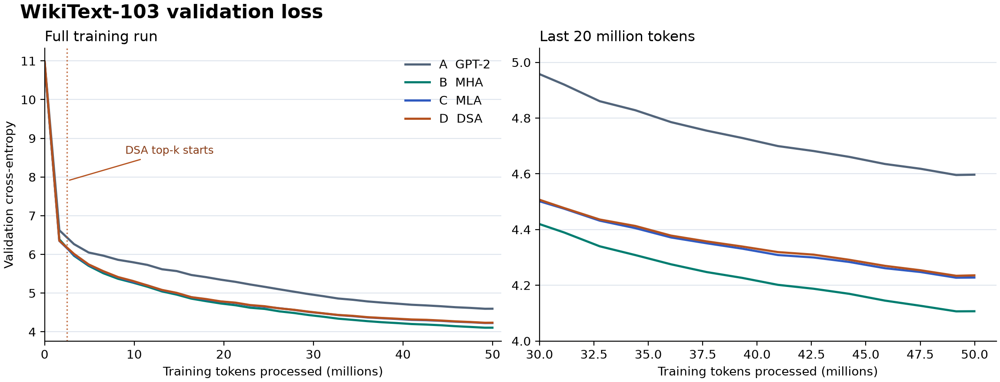

# nanoGPT

跟随 Karpathy 的 `build-nanogpt` 从零复现 GPT‑2，并在 WikiText‑103 上比较 GPT‑2、改造后的 MHA、MLA 和 DSA 四组模型。项目包含数据预处理、单卡及双卡 DDP 训练、checkpoint 续训、语言建模评估和 KV cache 推理基准。[Karpathy 的 build-nanogpt](https://github.com/karpathy/build-nanogpt)

## WikiText‑103 实验结果

四组均完成 3,052 次更新，训练 50,003,968 个 token。在本次单种子实验中，B 组 MHA 的测试 PPL 最低（63.53），C 组 MLA 的逻辑 KV cache 最小（1.81 MiB，较 B 组减少 86.5%）。



[完整实验报告](results/wikitext-103-seed1337/README.md) · [指标 JSON](results/wikitext-103-seed1337/metrics.json) · [验证曲线 CSV](results/wikitext-103-seed1337/validation-loss.csv)

## 运行项目

先在项目的 Python 环境中安装适合目标 GPU 和驱动的 PyTorch，再从仓库根目录执行：

```bash
python -m pip install -r requirements.txt
python wikitext.py --revision b08601e04326c79dfdd32d625aee71d232d685c3
python scripts/check_training.py
```

- [WikiText‑103 训练与评估](scripts/wikitext.md)涵盖单卡、双卡 DDP、续训及四组实验的评估命令。
- [TinyStories 与 KV cache 推理](scripts/prediction.md)说明数据准备流程和推理基准。
- [`GPT.py`](GPT.py)实现四种模型配置和训练入口，[`evaluate.py`](evaluate.py)计算交叉熵与困惑度，[`predict.py`](predict.py)记录开关缓存时的生成结果、延迟和显存。
