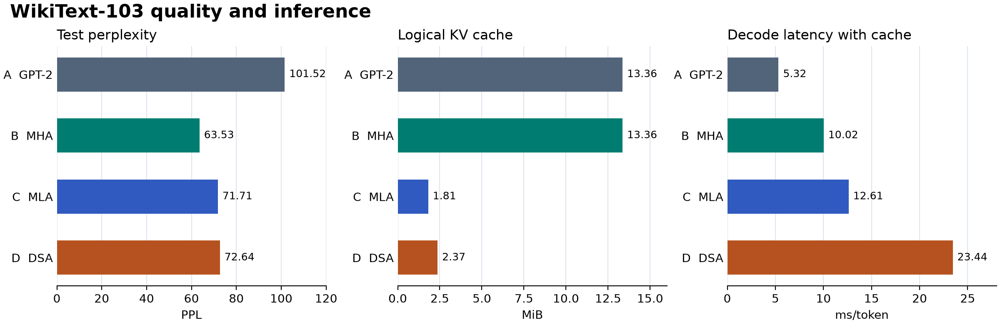
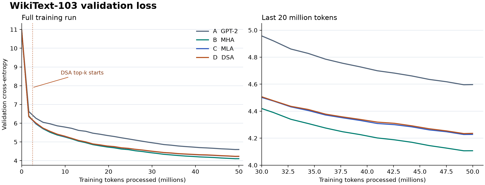

# WikiText-103 四组消融实验

四组从随机初始化开始，使用相同的 WikiText-103 分片、随机种子 1337、1024 token 序列长度和每次更新 16,384 个 token。每组完成 3,052 次更新，共训练 50,003,968 个 token。C 组在云端系统盘写满后，从第 3,000 次更新的 checkpoint 恢复，完成剩余 52 次更新。

[指标与训练配置](metrics.json) · [逐次验证数据](validation-loss.csv) · [训练、续训与评估命令](../../scripts/wikitext.md#four-group-ablation-on-wikitext-103)

数据来自 `Salesforce/wikitext` 的 `wikitext-103-raw-v1`，固定到提交 `b08601e04326c79dfdd32d625aee71d232d685c3`。复现时把该提交传给 `wikitext.py --revision`，并核对 [metrics.json](metrics.json) 中的分片清单哈希。实际训练用双卡 DDP、每卡 4 条序列、梯度累积 2 次、峰值学习率 `6e-4`、学习率预热 92 步。D 组前 153 次更新使用稠密注意力，之后开启 top‑k（128），索引器 KL 权重为 `1.0`。本次云端每 1,000 次更新保存 checkpoint，仓库启动脚本默认每 500 次保存。

## 四组结果

| 组别 | 架构 | 验证 PPL ↓ | 测试 PPL ↓ | 测试交叉熵 ↓ | 训练 token/s ↑ | 首 token 延迟 ms ↓ | 解码 ms/token ↓ | 逻辑 KV cache MiB ↓ | 峰值 CUDA 分配 MiB ↓ |
|---|---|---:|---:|---:|---:|---:|---:|---:|---:|
| A | GPT-2 | 101.69 | 101.52 | 4.6202 | 98,847 | 5.02 | 5.32 | 13.36 | 786.3 |
| B | RMSNorm + SwiGLU + RoPE + MHA | 63.03 | 63.53 | 4.1515 | 89,276 | 10.16 | 10.02 | 13.36 | 779.9 |
| C | 同 B 骨干，使用 MLA | 70.87 | 71.71 | 4.2727 | 89,485 | 12.68 | 12.61 | 1.81 | 703.3 |
| D | 同 C 骨干，加入 DSA | 71.37 | 72.64 | 4.2856 | — | 23.80 | 23.44 | 2.37 | 710.0 |

- **质量评估**使用各组最后的 checkpoint。八份评估 JSON 的数据集版本和清单哈希一致。四组均使用 GPT-2 BPE、FP32 和 1,024 token 的非重叠窗口，验证集评估 247,475 个目标 token，测试集评估 283,487 个。PPL 按本项目的 BPE token 口径计算。
- **训练吞吐**用日志中 step 100–2999 的非验证步取中位数，每组 2,871 条记录。报告归档缺少 D 组正式训练的控制台日志，因此 D 的吞吐以及预热前后的速度变化没有数据。
- **推理**表格使用开启 KV cache 的三次实测中位数。各组在同一张 NVIDIA GeForce RTX 4080 SUPER 上以 BF16 贪心生成，使用 253 token 的相同提示词并生成 128 个 token。逻辑缓存按缓存张量字节数计，峰值显存取 PyTorch CUDA 峰值已分配量。

## 架构变化带来的差异

- **A → B**：测试 PPL 下降 **37.4%**，同一推理基准下解码从 5.32 升到 10.02 ms/token。这一组对照反映 RMSNorm、SwiGLU 和 RoPE 的整套变化。
- **B → C**：逻辑 KV cache 从 **13.36 降到 1.81 MiB**，减少 **86.5%**。峰值 CUDA 分配下降 76.6 MiB，测试 PPL 上升 12.9%，每 token 解码耗时增加 25.9%。当前 MLA 在解码时会从历史 latent 重新展开 K/V，缓存压缩与实测延迟是两个指标。
- **C → D**：测试 PPL 从 71.71 升到 72.64，增幅 1.3%。每 token 解码耗时从 12.61 增至 23.44 ms，增加约 85.9%。DSA 额外缓存索引器的 Key，逻辑缓存从 1.81 增至 2.37 MiB。该实现对所有候选位置打分并通过掩码限制主注意力，此处速度反映当前实现及本次上下文长度。

## KV cache 开关对照

| 组别 | 无缓存解码 ms/token | 有缓存解码 ms/token | 解码速度倍率 | 128 个生成 token 一致 |
|---|---:|---:|---:|---|
| A | 5.25 | 5.32 | 0.99× | 否，第 18 个开始分叉 |
| B | 10.46 | 10.02 | 1.04× | 是 |
| C | 13.09 | 12.61 | 1.04× | 是 |
| D | 23.91 | 23.44 | 1.02× | 否，第 115 个开始分叉 |

A 和 D 的每种缓存模式内部三次生成结果均相同。首次分叉位置来自有缓存与无缓存的输出对照，日志不足以定位原因。耗时比反映这次单提示词实测。推理和质量结果均来自单种子实验。

## 验证 loss 曲线

训练循环在对应 step 更新前评估，因此横轴按已完成更新数乘以 16,384 计算。每组有 32 个验证点，最后一个验证点在最终更新前。上表的验证 PPL 来自最终 checkpoint 的独立完整评估。
